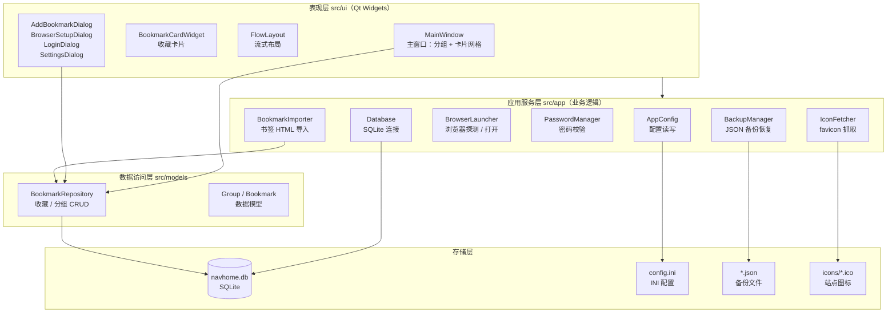
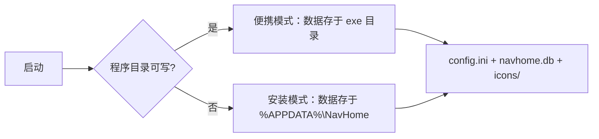

# 架构说明（Architecture）

> 导航之家（NavHome）是一个**本地单机、离线可用**的 Windows 桌面应用。整体采用经典的四层分层架构，UI 与数据访问解耦，便于维护与扩展。

## 一、总体架构图

## 二、分层职责

| 层次 | 目录 | 职责 | 关键类 |
|------|------|------|--------|
| 表现层 | `src/ui/` | 界面展示与交互，不含业务规则 | `MainWindow`、`BookmarkCardWidget`、`FlowLayout`、各类对话框 |
| 应用服务层 | `src/app/` | 可复用的业务能力，供 UI 调用 | `AppConfig`、`BrowserLauncher`、`BackupManager`、`IconFetcher` 等 |
| 数据访问层 | `src/models/` | 数据结构定义 + SQLite 读写封装 | `BookmarkRepository`、`Group`、`Bookmark` |
| 存储层 | 数据目录 | 持久化存储 | SQLite 数据库、`config.ini`、JSON 备份、图标文件 |

### 依赖规则

依赖方向自上而下：**表现层 → 应用服务层 / 数据访问层 → 存储层**。应用服务层与数据访问层之间不存在反向依赖，UI 不直接写 SQL，数据访问层不感知界面。

## 三、核心模块说明

### 1. MainWindow（主窗口）

程序的核心界面，负责组织左侧分组菜单与右侧收藏卡片网格，并作为各对话框与业务能力的调度入口：

- 左侧：分组列表（`QListWidget#groupList`）+ 分组增删改按钮。
- 右侧：搜索框、工具栏（添加收藏 / 多选 / 设置）、批量操作栏、卡片流式网格（`FlowLayout`）。
- 主题切换：持有 `applyStyle()` / `themeStylesheet()`，将样式表应用到全局 `qApp`（含登录等早期对话框）。

### 2. BookmarkRepository（数据访问层）

封装所有 `groups` / `bookmarks` 表的读写，是 UI 与 SQLite 之间唯一的交互通道。提供分组、收藏的增删改查、搜索、批量移动、图标更新等接口。

### 3. AppConfig（配置）

基于 `QSettings` 读写 `config.ini`，集中管理 `[app]`（默认浏览器、主题、语言）、`[security]`（密码）、`[ui]`（图标序号、背景）、`[backup]`（自动备份）各段字段。首次启动生成带注释的模板，便于非专业用户手工编辑（如密码找回）。

### 4. Database（连接）

SQLite 连接的单例封装，负责打开（不存在则创建）数据库、初始化表结构、生命周期管理。

### 5. 浏览器相关（BrowserLauncher / IconFetcher）

- `BrowserLauncher`：通过注册表 `App Paths` + 常见安装路径兜底探测本机浏览器；用 `QFileIconProvider` 提取浏览器图标；通过命令行参数或系统默认浏览器打开网址。
- `IconFetcher`：使用 `QNetworkAccessManager` 异步抓取网站 favicon，成功后回写数据库并刷新界面。

## 四、数据目录策略

应用启动时自动选择数据目录（`chooseDataDir()`）：

- **便携模式**：exe 所在目录可写时，数据随程序存放，复制整个目录即可迁移。
- **安装模式**：安装在公共目录（如 `D:\NavHome`，管理员安装）时，普通用户（含 AD 域）对安装目录通常无写权限，数据自动落到 `%APPDATA%\NavHome`，保证各用户独立、卸载/重装不丢数据。

## 五、关键技术选型

| 项目 | 选型 | 说明 |
|------|------|------|
| 语言 / 框架 | C++17 + Qt 6（Widgets / Sql / Network） | 跨平台桌面 UI |
| 数据库 | SQLite（Qt Sql 模块） | 本地单文件，无需服务端 |
| 配置 | `config.ini`（INI 格式） | 可手工编辑 |
| 构建 | CMake + Ninja（MSYS2 mingw64） | 产物为单 `NavHome.exe` |
| 打包 | Inno Setup 6 | 单文件安装包，默认安装到 D 盘，所有用户可用 |

## 六、相关文档

- 业务流程图：[business-flow.md](business-flow.md)
- 使用与构建说明：项目根目录 [README.md](../README.md)
