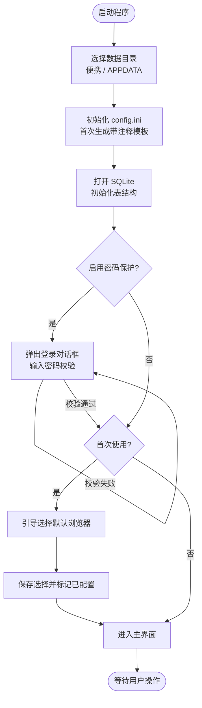
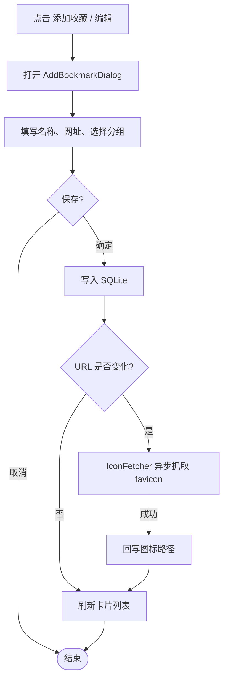
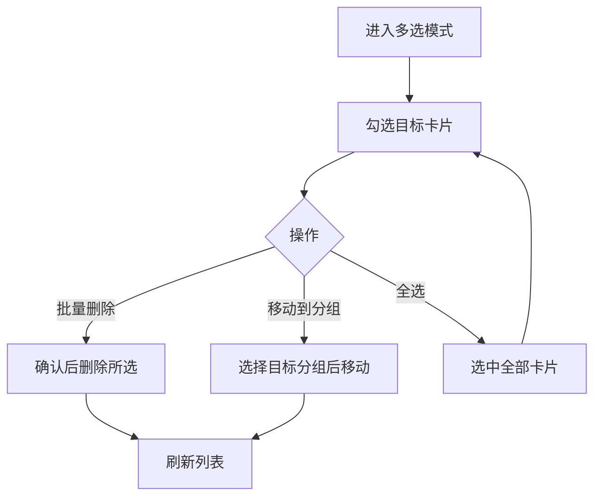
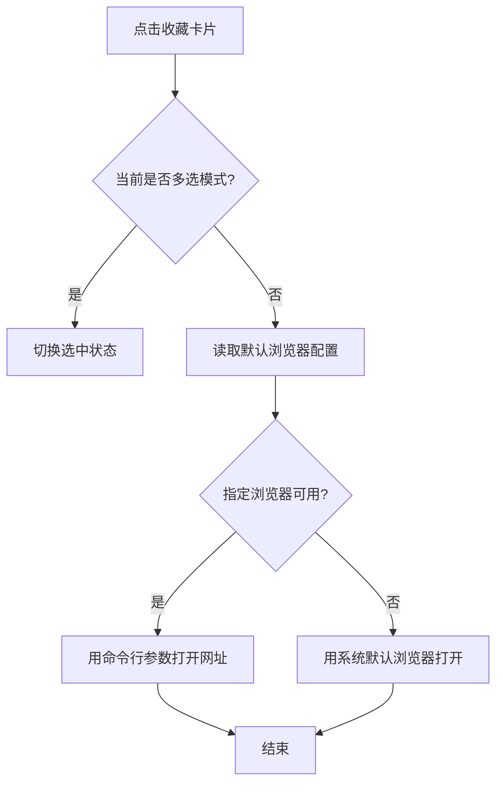
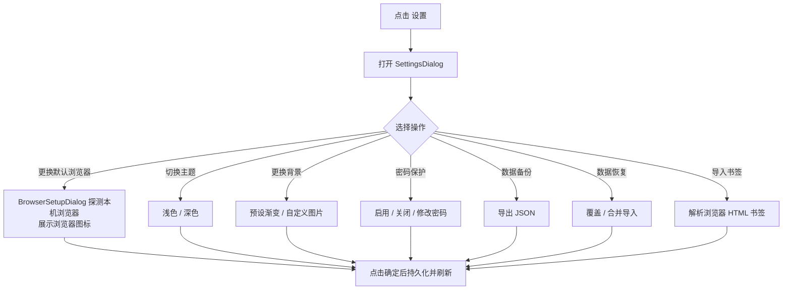
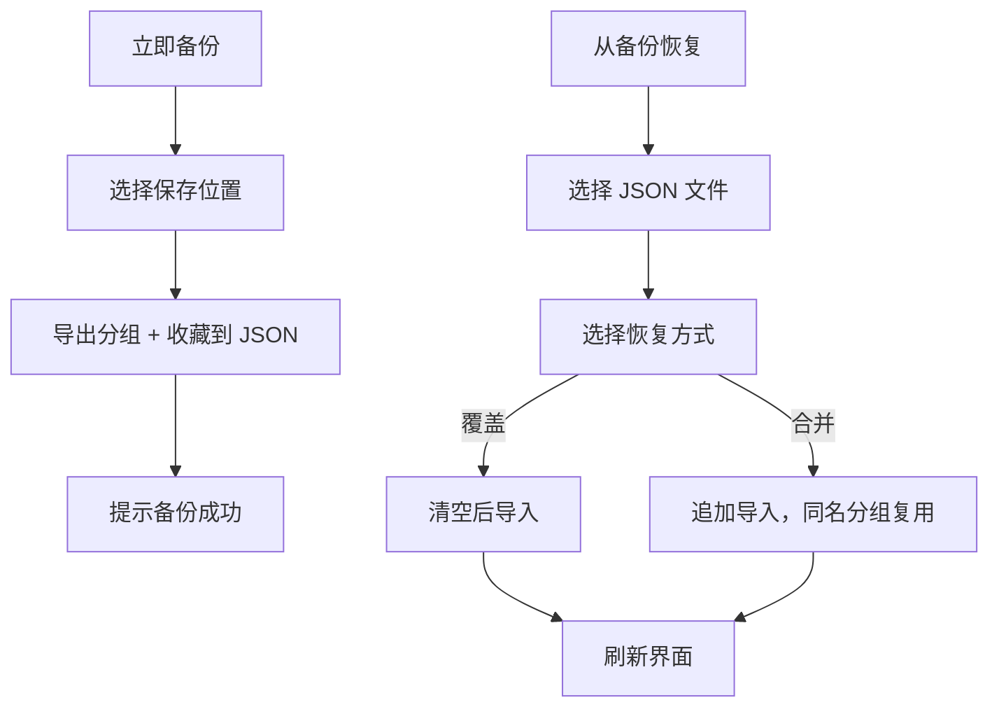

# 业务流程说明（Business Flow）

> 本文用流程图描述「导航之家」的核心业务流程。流程图采用 Mermaid 语法，在支持 Mermaid 的 Markdown 阅读器（如 GitHub、VS Code）中可直接渲染。

## 一、启动流程

## 二、收藏管理流程

### 添加 / 编辑收藏

### 删除 / 批量操作

## 三、打开网址流程

## 四、设置与配置流程

## 五、备份与恢复流程

## 六、关键设计要点

- **浏览器探测**：优先读注册表 `App Paths`，失败时回退到常见安装路径；系统默认浏览器通过 `UserChoice` 注册表识别。
- **favicon 抓取**：异步进行，不阻塞界面；失败时回退为「名称首字符 + 彩色背景」的占位图标。
- **密码存储**：默认 SHA-256 哈希；也可通过 `config.ini` 切换为明文。忘记密码可通过编辑配置关闭保护。
- **数据一致性**：书签 HTML 导入在单个事务内完成，失败自动回滚。

## 七、相关文档

- 架构说明：[architecture.md](architecture.md)
- 使用与构建说明：项目根目录 [README.md](../README.md)
